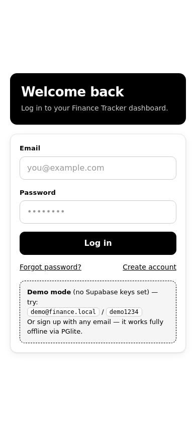
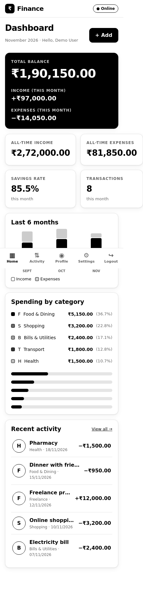
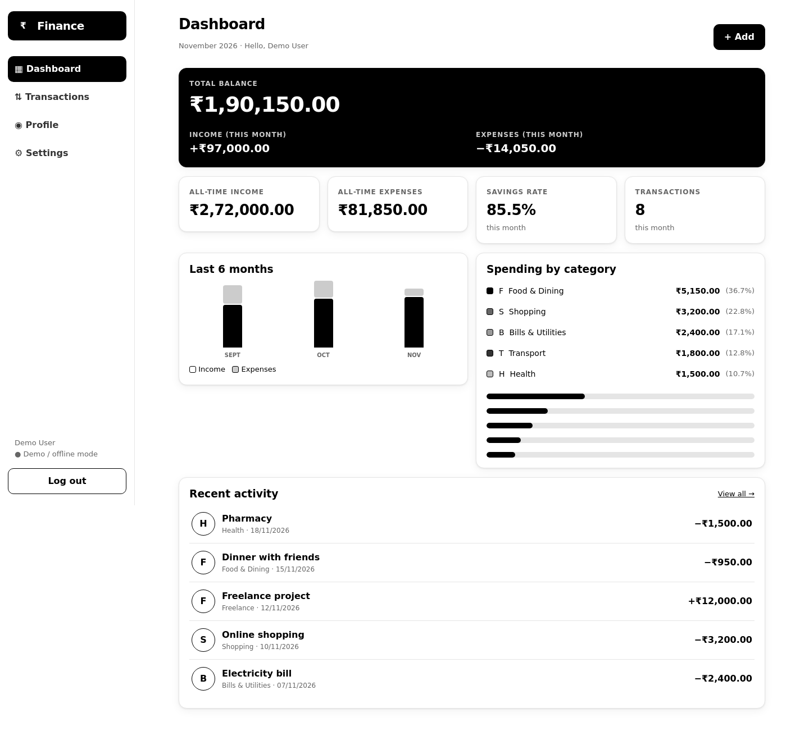

# Finance Tracker

**Black & white, mobile-first personal finance PWA.** Vue 3 + Vite frontend, Supabase backend
(Postgres + Auth), and a full offline database in the browser via **PGlite** (Postgres compiled
to WebAssembly). Ships ready for GitHub Pages — with **zero configuration** it runs in demo /
offline mode, so the deployed link is usable before you even create a Supabase project.

```
Login  →  Dashboard · Transactions · Profile · Settings
```

| | |
|---|---|
| **Frontend** | Vue 3.5, Vite 6, Pinia, vue-router 4 |
| **Backend** | Supabase (Postgres + Auth + RLS + RPC functions) |
| **Offline** | PGlite (WASM Postgres) persisted to IndexedDB + a sync queue |
| **PWA** | Workbox service worker, installable manifest, precached WASM |
| **Style** | Strict black & white, mobile-first (bottom tabs) → desktop (sidebar) |
| **Deploy** | GitHub Pages via GitHub Actions |
| **Version** | see [`VERSION`](./VERSION) · history in [`CHANGELOG.md`](./CHANGELOG.md) |

## Screenshots

| Mobile (login) | Mobile (dashboard) | Desktop (dashboard) |
|---|---|---|
|  |  |  |

More in [`docs/screenshots`](./docs/screenshots): signup, forgot password, transactions,
new-transaction sheet, profile, settings, and an offline reload
(`transactions-offline-mobile.png`).

---

## Quick start

```bash
npm install
npm run dev        # http://localhost:5173
```

No `.env` needed — the app boots in **demo mode**:

```
email:    demo@finance.local
password: demo1234
```

(Demo mode stores everything in the browser with PGlite: 11 categories and three months of
sample transactions are seeded on first login. You can also sign up with any email.)

## Connect Supabase (production mode)

1. Create a project at [supabase.com](https://supabase.com).
2. Open **SQL Editor → New query**, paste the entire [`supabase_schema.sql`](./supabase_schema.sql)
   and **Run**. This creates every table, RLS policy, trigger, view and RPC function, and seeds
   default categories for each new signup.
3. Copy `.env.example` to `.env` and fill in:

```bash
VITE_SUPABASE_URL=https://<project-ref>.supabase.co
VITE_SUPABASE_ANON_KEY=<anon public key>
```

4. `npm run dev` again. The app now uses Supabase Auth and calls Postgres functions through
   `supabase.rpc(...)`. Offline writes still land in PGlite and are flushed on reconnect.

> The anon key is safe to expose (it only ever gets what RLS allows). **Never** put the
> `service_role` key in the frontend.

## Scripts

| Command | What it does |
|---|---|
| `npm run dev` | Dev server on `0.0.0.0:5173` |
| `npm run build` | Production build to `dist/` (also emits `sw.js` + `manifest.webmanifest`) |
| `npm run preview` | Serve the build on `0.0.0.0:4173` (needed to test the service worker) |
| `npm run lint` | Syntax check |

## Deploy to GitHub Pages

The repo already contains `.github/workflows/deploy.yml`:

1. **Settings → Pages → Build and deployment → Source: GitHub Actions.**
2. *(Optional, for Supabase in production)* **Settings → Secrets and variables → Actions**:
   add `VITE_SUPABASE_URL` and `VITE_SUPABASE_ANON_KEY`. Without them the site deploys in
   demo/offline mode.
3. Push to `main`. The workflow builds and publishes to
   **https://harsh10101993.github.io/finance_tracker/**.

`vite.config.js` switches `base` to `/finance_tracker/` when `GITHUB_ACTIONS=true`, and
`public/404.html` provides the SPA deep-link fallback that GitHub Pages needs.

## Architecture

```
src/
├── main.js                 bootstrap: Pinia, router, session restore, PGlite warm-up
├── App.vue
├── assets/style.css        black & white design system (mobile-first, desktop ≥1024px)
├── router/index.js         guest routes (/login /signup /forgot-password) + auth guard
├── lib/
│   ├── supabase.js         client (only created when env vars exist)
│   ├── pglite.js           offline Postgres: local_* mirror tables + sync_queue
│   ├── financeApi.js       THE data boundary — Supabase RPC online, PGlite offline
│   └── utils.js            money/date formatting, constants, catMark()
├── stores/
│   ├── auth.js             Supabase Auth or PGlite local accounts (+ demo seed)
│   └── finance.js          dashboard/transactions/profile/settings state
├── components/             AppLayout (tabs/sidebar), TransactionModal
└── views/                  Login, Signup, ForgotPassword, Dashboard,
                            Transactions, Profile, Settings
supabase_schema.sql         single source of truth for the database
```

### Data flow — one interface, two engines

```
View / Store  →  src/lib/financeApi.js  ─┬─ online  →  supabase.rpc('create_transaction', …)
                                          └─ offline →  PGlite SQL + enqueue in sync_queue
                                                                        │
                                                     reconnect / "Sync now" → replay queue
```

Business logic lives **in Postgres functions**, not in the frontend — validation, aggregation,
audit rows and default seeding all happen server-side (see `supabase_schema.sql` §5).

### RPC functions

| Area | Functions |
|---|---|
| Dashboard | `get_dashboard_stats`, `get_monthly_summary`, `get_category_breakdown` |
| Transactions | `create_transaction`, `update_transaction`, `delete_transaction`, `list_transactions` |
| Categories | `list_categories`, `create_category`, `delete_category` |
| Profile | `get_profile`, `upsert_profile` |
| Settings | `get_settings`, `upsert_settings` |
| Budgets | `upsert_budget`, `get_budget_summary` |
| Data | `export_user_data`, `delete_user_data` |

Every function is `SECURITY DEFINER` with `search_path` pinned and an `auth.uid()` ownership
check; every table has RLS enabled with per-user policies.

## Offline & PWA behaviour

- The service worker precaches the app shell **and** PGlite's WASM/data blobs, so the first
  offline reload already has a working database.
- Offline writes go to `local_transactions` / `local_categories` / … and a `sync_queue` row.
- On reconnect (or **Settings → Sync now**) the queue is replayed through the same RPCs.
- An online/offline banner shows the current state, and `Settings → Install app` triggers the
  browser install prompt.

## Design rules

- Only black `#000`, white `#fff` and neutral grays — no accent colours anywhere.
- Mobile-first: bottom tab bar + top bar under 1024 px, fixed sidebar at ≥1024 px,
  2-up stat grid on phones and 4-up from 768 px.
- `env(safe-area-inset-*)` respected for notched devices.

## Roadmap

- Budgets UI (RPCs already exist: `upsert_budget`, `get_budget_summary`).
- Password-reset deep link handling for Supabase Auth.
- CSV import, recurring transactions, per-category icons.

## License

See [LICENSE](./LICENSE).
